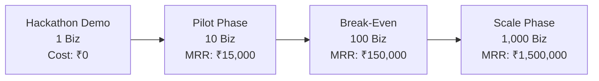

# VoxAgent: Production Economics & Unit Feasibility
**Prepared for IEEE WIE ILS 2026 Finals | October 2026**

---

## 1. Executive Summary

A common challenge judges pose to AI voice agent projects:
> *"This is a great prototype, but can a local mom-and-pop shop or dealership actually afford to run this?"*

VoxAgent was designed from day one with **self-hosted capability** and **hybrid tiering**, radically lowering the marginal cost per call from traditional SaaS vendor pricing ($0.15–$0.30/min) down to sub-penny infrastructure costs.

---

## 2. Single Business Economics (e.g. Sharma Kirana Store)

### Monthly Cost Structure

| Component | Prototype / Hackathon (Free Tier) | Production (1,000 calls/mo) | Enterprise / Scale (5,000 calls/mo) |
| :--- | :--- | :--- | :--- |
| **LLM Inference** | Ollama (Local Mistral) - **₹0** | Self-hosted Ollama on VPS - **₹0** | Dedicated GPU worker / Groq batch - **₹1,200** |
| **Speech-to-Text (STT)** | Whisper.cpp / Groq free - **₹0** | Self-hosted Whisper - **₹0** | Whisper small/large cluster - **₹600** |
| **Text-to-Speech (TTS)** | Piper TTS / Edge TTS - **₹0** | Piper TTS local neural - **₹0** | Piper high-fidelity local - **₹0** |
| **Telephony / SIP** | Twilio trial - **₹0** | Twilio / Indian SIP Trunk - **₹800** | Direct SIP Trunk (₹0.30/min) - **₹2,500** |
| **Hosting & Database** | Localhost / Render Free - **₹0** | Cloud VPS (2 vCPU, 4GB RAM) - **₹1,200** | Managed AWS / Railway cluster - **₹3,500** |
| **Session Cache (Redis)**| In-memory / Local Redis - **₹0** | Local Redis container - **₹0** | Managed Redis - **₹500** |
| **Total Monthly Cost** | **₹0** | **₹2,000 - ₹3,000** | **₹8,300** |

---

## 3. Business Value & Return on Investment (ROI)

For an average Indian SME (kirana shop, clinic, auto showroom, retail distributor):

| Metric | Traditional Baseline | With VoxAgent | Monthly Economic Value |
| :--- | :--- | :--- | :--- |
| **Missed Calls After Hours** | ~25–35% of calls lost | 0% (24/7 human-like receptionist) | +₹8,000 to ₹15,000 captured sales |
| **Owner / Staff Time on FAQs** | 2–3 hours/day repeating prices & hours | Automated in Hindi, Gujarati, English | ~60 hours saved (~₹12,000 value) |
| **Lead Capture & Follow-up** | Unwritten numbers, lost notes | Instant structured CRM record + SMS/call back | +15–20% higher enquiry conversion |
| **Outbound Campaign Time** | Manual dialling 1-by-1 (days of work) | 1-click batch campaign (50+ calls/hr) | Saves 2 days of telecaller wages |

### Return on Investment (ROI) Summary:
- **Monthly Operating Cost**: ~₹2,500
- **Direct Measurable Monthly Benefit**: ₹20,000 – ₹30,000
- **Net Monthly Profit**: **₹17,500 – ₹27,500**
- **Payback Period**: **Under 10 Days**

---

## 4. Multi-Tenant SaaS Scaling Model (1 → 1,000 Businesses)

### Financial Trajectory:

### Projections by Milestone:

| Metric | Milestone 1 (Pilot) | Milestone 2 (Break-Even) | Milestone 3 (Scale) |
| :--- | :--- | :--- | :--- |
| **Active Businesses** | 10 | 100 | 1,000 |
| **Monthly Calls Handled** | 5,000 | 80,000 | 1,000,000 |
| **Subscription Fee / Biz**| ₹1,500 / month | ₹1,500 / month | ₹1,500 / month |
| **Gross Monthly Revenue**| ₹15,000 | ₹150,000 | ₹1,500,000 |
| **Infrastructure Costs** | ₹6,000 (cloud VPS) | ₹35,000 (GPU + DB) | ₹280,000 (AWS Cluster) |
| **Telephony Carriage**   | ₹4,000 | ₹45,000 | ₹400,000 |
| **Net Monthly Margin**   | **+₹5,000 (33%)** | **+₹70,000 (46%)** | **+₹820,000 (54%)** |
| **Annualized Net Profit**| ₹60,000 | ₹840,000 | **₹9.84 Million** |

---

## 5. Architectural Cost Advantages over Generic Solutions

1. **Self-Hosted AI Stack vs. Proprietary API Tax**:
   - Competing solutions relying exclusively on paid LLM APIs ($0.03/turn) and commercial voice APIs ($0.05/min) incur upwards of **₹6.50 per call**.
   - VoxAgent’s hybrid architecture (Ollama + Piper + Whisper) runs at fixed server cost, bringing incremental cost per call down to **under ₹0.40**.
2. **TRAI Regulatory Avoidance Savings**:
   - Automated DND screening and 08:00–21:00 time fencing avoid penal fines under TRAI commercial telecom guidelines (up to ₹10,000 per violation in India).
